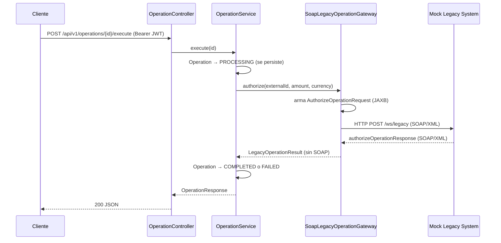

# LegacyBridge — Gateway REST → SOAP para sistemas legacy

API REST en Spring Boot que funciona como pasarela entre aplicaciones modernas (REST/JSON) y un sistema core legacy que solo expone servicios SOAP/XML. El cliente nunca ve XML: LegacyBridge autentica, valida, traduce la petición a SOAP, la envía al sistema legacy y guarda el estado de cada operación.

Es el problema típico del sector financiero: canales digitales nuevos que necesitan hablar con un core bancario antiguo sin acoplarse a su protocolo.

> **Proyecto personal de portafolio.** No reproduce código, endpoints, WSDL, entidades ni reglas de negocio de ningún sistema empresarial real. Toda la integración corre contra un **Mock Legacy System** propio incluido en este repositorio.

**Estado:** MVP completo (3 fases) · 30 tests pasando.

```
Cliente  ──HTTP + REST/JSON + JWT──▶  LegacyBridge  ──HTTP + SOAP/XML──▶  Sistema legacy
```

REST y SOAP no reemplazan HTTP: ambos viajan sobre HTTP. Lo que cambia entre los dos tramos es el formato del mensaje y el protocolo de aplicación.

---

## Índice

1. [Qué demuestra este proyecto](#1-qué-demuestra-este-proyecto)
2. [Inicio rápido](#2-inicio-rápido)
3. [Arquitectura](#3-arquitectura)
4. [Integración con el sistema legacy](#4-integración-con-el-sistema-legacy)
5. [Autenticación y autorización](#5-autenticación-y-autorización)
6. [Endpoints](#6-endpoints)
7. [Ejemplos de request/response](#7-ejemplos-de-requestresponse)
8. [Manejo de errores](#8-manejo-de-errores)
9. [Decisiones de diseño](#9-decisiones-de-diseño)
10. [Tecnologías](#10-tecnologías)
11. [Configuración y SQL Server](#11-configuración-y-sql-server)
12. [Tests](#12-tests)
13. [Limitaciones conocidas](#13-limitaciones-conocidas)
14. [Roadmap](#14-roadmap)

---

## 1. Qué demuestra este proyecto

- **Integración SOAP contract-first:** contrato XSD, WSDL publicado, cliente con Spring-WS (`WebServiceTemplate`) y mapeo objeto ↔ XML con JAXB.
- **Patrón Gateway:** la lógica de negocio depende de una interfaz (`LegacyOperationGateway`), nunca de SOAP. Cambiar el protocolo del legacy solo afecta a una clase.
- **Seguridad:** Spring Security con JWT, roles `ROLE_USER` / `ROLE_ADMIN` con `@PreAuthorize`, contraseñas con BCrypt.
- **Manejo de errores por capa:** contrato único `ApiError`, y **502 Bad Gateway** cuando falla el sistema legacy.
- **Ciclo de vida de una operación:** `PENDING → PROCESSING → COMPLETED | FAILED`, persistido en SQL Server.
- **Tests de punta a punta:** login → crear operación → ejecutar → SOAP real sobre HTTP contra el legacy simulado.

---

## 2. Inicio rápido

Requisitos: Java 17+, Maven 3.9+ y Docker (o Colima en macOS).

```bash
# 1. SQL Server local
docker run -e "ACCEPT_EULA=Y" -e "MSSQL_SA_PASSWORD=Legacybridge#1" \
  -p 1433:1433 --name legacybridge-sqlserver -d mcr.microsoft.com/azure-sql-edge

# 2. Crear la base de datos (ver sección 11 si no tienes un cliente SQL)

# 3. Arrancar la API
mvn spring-boot:run
```

- API: `http://localhost:8080`
- Swagger UI: `http://localhost:8080/swagger-ui.html`
- WSDL del legacy simulado: `http://localhost:8080/ws/legacyOperation.wsdl`

### Usuarios de desarrollo

Al arrancar, `DemoUserSeeder` crea dos usuarios **solo para desarrollo**:

| Usuario | Password | Rol |
|---|---|---|
| `user.demo` | `User#12345` | `ROLE_USER` |
| `admin.demo` | `Admin#12345` | `ROLE_ADMIN` |

### Probar el flujo completo con curl

```bash
# 1. Login
TOKEN=$(curl -s -X POST http://localhost:8080/api/v1/auth/login \
  -H "Content-Type: application/json" \
  -d '{"username":"admin.demo","password":"Admin#12345"}' \
  | python3 -c "import sys,json;print(json.load(sys.stdin)['token'])")

# 2. Crear una operación
OP_ID=$(curl -s -X POST http://localhost:8080/api/v1/operations \
  -H "Authorization: Bearer $TOKEN" -H "Content-Type: application/json" \
  -d '{"externalId":"OP-2001","amount":100.00,"currency":"PEN"}' \
  | python3 -c "import sys,json;print(json.load(sys.stdin)['id'])")

# 3. Ejecutarla contra el sistema legacy (SOAP/XML por debajo)
curl -X POST "http://localhost:8080/api/v1/operations/$OP_ID/execute" \
  -H "Authorization: Bearer $TOKEN"
```

Para ver el rechazo del legacy, crea una operación con `amount` mayor a `100000`.

---

## 3. Arquitectura

Organización por feature: cada dominio es autocontenido.

```
com.legacybridge
├── operation
│   ├── controller   -> API REST de operaciones
│   ├── dto          -> contratos de entrada/salida (records)
│   ├── entity       -> Operation, OperationStatus
│   ├── repository   -> Spring Data JPA
│   └── service      -> lógica de negocio y ciclo de vida
├── auth
│   ├── controller   -> POST /api/v1/auth/login
│   ├── dto          -> LoginRequest / LoginResponse
│   ├── entity       -> User, Role
│   ├── repository   -> UserRepository
│   ├── service      -> AuthenticationService, UserDetailsServiceImpl
│   ├── security     -> JwtService, JwtAuthenticationFilter
│   └── DemoUserSeeder (solo desarrollo)
├── legacy
│   ├── LegacyOperationGateway         -> interfaz: frontera hacia el legacy
│   ├── SoapLegacyOperationGateway     -> implementación SOAP (WebServiceTemplate)
│   ├── LegacyOperationResult          -> resultado interno, sin nada de SOAP
│   ├── LegacyIntegrationException
│   ├── jaxb/                          -> mensajes SOAP anotados con JAXB
│   └── mock/MockLegacyEndpoint        -> sistema legacy simulado (@Endpoint)
├── common/exception  -> manejo global de errores (@RestControllerAdvice)
└── config
    ├── SecurityConfig
    ├── OpenApiConfig
    └── LegacySoapConfig  -> cliente SOAP + servlet del legacy simulado
```

La entidad `Operation` nunca se expone directamente: los controllers solo hablan en DTOs, y `OperationService` solo conoce la interfaz `LegacyOperationGateway`, nunca clases JAXB ni Spring-WS.

---

## 4. Integración con el sistema legacy



**`LegacyOperationGateway`.** Frontera explícita entre el dominio de LegacyBridge y el sistema legacy. Tiene un solo método (`authorize(externalId, amount, currency)`) a propósito: el servicio no necesita conocer SOAP, XML, JAXB ni el transporte.

**`SoapLegacyOperationGateway`.** Única implementación y única clase del proyecto que importa Spring-WS o JAXB. Arma el request, lo envía con `WebServiceTemplate.marshalSendAndReceive(...)` y traduce la respuesta, o cualquier fallo de comunicación, a `LegacyOperationResult` / `LegacyIntegrationException`.

**Mock Legacy System (`MockLegacyEndpoint`).** Simula el sistema legacy para poder ejecutar el proyecto sin depender de un tercero. Corre embebido en la misma app (en `/ws/*`), pero se le habla **por HTTP real**, exactamente como a un legacy en otra red: la única diferencia es la URL (`legacy.soap.endpoint-url`). Regla simulada, determinística: rechaza operaciones con `amount > 100000` y autoriza el resto con un `legacyOperationId` único.

### XML intercambiado (simplificado)

```xml
<!-- Request: LegacyBridge → Mock Legacy System -->
<authorizeOperationRequest xmlns="http://legacybridge.com/legacy/operation">
  <externalId>OP-1001</externalId>
  <amount>2500.00</amount>
  <currency>PEN</currency>
</authorizeOperationRequest>
```

```xml
<!-- Response: Mock Legacy System → LegacyBridge -->
<authorizeOperationResponse xmlns="http://legacybridge.com/legacy/operation">
  <legacyOperationId>LEGACY-0d9e61cd-5802-4eb9-a049-83bff8632cd0</legacyOperationId>
  <status>OK</status>
  <message>Operacion autorizada por el sistema legacy</message>
</authorizeOperationResponse>
```

---

## 5. Autenticación y autorización

```
POST /api/v1/auth/login (usuario + password)
  → AuthenticationManager valida con UserDetailsServiceImpl + BCrypt
  → JwtService genera el JWT
  → respuesta: { token, tokenType, expiresInSeconds }

Request con Authorization: Bearer <token>
  → JwtAuthenticationFilter valida el token y puebla el SecurityContext
  → SecurityFilterChain exige autenticación
  → @PreAuthorize exige ROLE_ADMIN para crear y ejecutar operaciones
```

Consultar operaciones solo requiere estar autenticado. Crear y ejecutar exige `ROLE_ADMIN`: una operación financiera no la autoriza cualquiera.

---

## 6. Endpoints

| Método | Ruta | Requiere | Descripción |
|---|---|---|---|
| `POST` | `/api/v1/auth/login` | — | Autentica y devuelve un JWT |
| `GET` | `/api/v1/operations` | Usuario autenticado | Lista las operaciones |
| `GET` | `/api/v1/operations/{id}` | Usuario autenticado | Obtiene una operación |
| `POST` | `/api/v1/operations` | `ROLE_ADMIN` | Crea una operación en estado `PENDING` |
| `POST` | `/api/v1/operations/{id}/execute` | `ROLE_ADMIN` | La envía al legacy por SOAP y actualiza su estado |

---

## 7. Ejemplos de request/response

**Login**

```http
POST /api/v1/auth/login
Content-Type: application/json

{ "username": "admin.demo", "password": "Admin#12345" }
```

```json
{ "token": "eyJhbGciOiJIUzM4NCJ9...", "tokenType": "Bearer", "expiresInSeconds": 3600 }
```

**Crear una operación**

```http
POST /api/v1/operations
Authorization: Bearer <token de ROLE_ADMIN>
Content-Type: application/json

{ "externalId": "OP-1001", "amount": 2500.00, "currency": "PEN" }
```

```json
{
  "id": 1,
  "externalId": "OP-1001",
  "amount": 2500.00,
  "currency": "PEN",
  "status": "PENDING",
  "createdAt": "2026-09-07T10:00:00Z",
  "updatedAt": "2026-09-07T10:00:00Z"
}
```

**Ejecutar: el legacy la autoriza**

```json
{
  "id": 1,
  "externalId": "OP-1001",
  "amount": 2500.00,
  "currency": "PEN",
  "status": "COMPLETED",
  "legacyOperationId": "LEGACY-0d9e61cd-5802-4eb9-a049-83bff8632cd0",
  "createdAt": "2026-09-07T10:00:00Z",
  "updatedAt": "2026-09-07T10:00:05Z"
}
```

**Ejecutar: el legacy la rechaza** (monto mayor a 100000)

```json
{
  "id": 2,
  "externalId": "OP-9999",
  "amount": 999999.00,
  "currency": "PEN",
  "status": "FAILED",
  "legacyOperationId": null,
  "createdAt": "2026-09-07T10:00:00Z",
  "updatedAt": "2026-09-07T10:00:05Z"
}
```

**El legacy no responde (502)**

```json
{
  "timestamp": "2026-09-07T10:00:00Z",
  "status": 502,
  "error": "Bad Gateway",
  "message": "No se pudo establecer comunicacion con el sistema legacy",
  "path": "/api/v1/operations/1/execute",
  "details": []
}
```

---

## 8. Manejo de errores

Todas las respuestas de error usan el mismo contrato `ApiError` (`timestamp`, `status`, `error`, `message`, `path`, `details`), sin importar si el error nace en Bean Validation, Spring Security o la integración legacy.

| Situación | HTTP | Origen |
|---|---|---|
| Body inválido (falta un campo, monto ≤ 0) | 400 | `MethodArgumentNotValidException` |
| Sin token, token inválido o expirado | 401 | `AuthenticationEntryPoint` de `SecurityConfig` |
| Autenticado pero sin `ROLE_ADMIN` | 403 | `AccessDeniedHandler` / `@PreAuthorize` |
| Operación inexistente | 404 | `ResourceNotFoundException` |
| `externalId` duplicado | 409 | `DataIntegrityViolationException` |
| El legacy no responde o la respuesta no se puede interpretar | 502 | `LegacyIntegrationException` |
| Error no anticipado | 500 | Catch-all |

---

## 9. Decisiones de diseño

- **502 y no 500 ante fallas del legacy.** El error no es de LegacyBridge sino del sistema aguas arriba; 502 Bad Gateway comunica eso al cliente y a quien monitorea.
- **`PROCESSING` se persiste antes de llamar al legacy.** Si la llamada se cae a mitad de camino, la operación no queda en `PENDING` como si nunca se hubiera intentado: queda registrado que se envió.
- **`execute()` no es `@Transactional`.** Cada cambio de estado se guarda por separado. Así no se mantiene una transacción de base de datos abierta mientras se espera una llamada de red al legacy, y cada estado intermedio queda visible.
- **401 y 403 explícitos.** Spring Security por defecto responde 403 a peticiones sin token; se configuraron `AuthenticationEntryPoint` y `AccessDeniedHandler` para distinguir "no autenticado" de "sin permiso" y responder con el mismo `ApiError`.
- **Legacy simulado por HTTP real**, no un mock en memoria: el cliente SOAP se ejercita igual que contra un sistema externo.
- **JAXB con `setClassesToBeBound`** en lugar de `setContextPath`, para no depender de clases generadas (`ObjectFactory` / `jaxb.index`).

---

## 10. Tecnologías

| Categoría | Tecnología |
|---|---|
| Lenguaje | Java 17 |
| Framework | Spring Boot 3.3.4 (Spring MVC, Spring Data JPA) |
| Seguridad | Spring Security, JWT (JJWT 0.12.6), BCrypt |
| Integración legacy | Spring Web Services 4, JAXB (Jakarta XML Bind), WSDL (wsdl4j) |
| Base de datos | Microsoft SQL Server (H2 en memoria para tests) |
| Validación | Jakarta Bean Validation |
| Documentación | springdoc-openapi (Swagger UI) + WSDL publicado |
| Testing | JUnit 5, Mockito, MockMvc, Spring Security Test, Spring-WS Test |
| Build | Maven |
| Infraestructura local | Docker / Colima (SQL Server) |
| Utilidades | Lombok |

---

## 11. Configuración y SQL Server

La configuración vive en `src/main/resources/application.yml` y se resuelve por variables de entorno. Los valores por defecto son **solo de desarrollo local**; el repositorio no contiene credenciales reales.

| Variable | Default (desarrollo) | Descripción |
|---|---|---|
| `DB_HOST` | `localhost` | Host de SQL Server |
| `DB_PORT` | `1433` | Puerto |
| `DB_NAME` | `legacybridge` | Base de datos |
| `DB_USERNAME` | `sa` | Usuario |
| `DB_PASSWORD` | `Legacybridge#1` | Password del contenedor local |
| `JWT_SECRET` | valor `dev-only-...` | Secreto de firma del JWT. **En cualquier entorno real debe venir de una variable de entorno o un vault** |
| `JWT_EXPIRATION_MS` | `3600000` | Vigencia del token (1 hora) |
| `LEGACY_SOAP_URL` | `http://localhost:8080/ws/legacy` | URL del sistema legacy; por defecto, el simulado embebido |
| `SERVER_PORT` | `8080` | Puerto de la aplicación |

La URL JDBC usa `encrypt=true;trustServerCertificate=true` para conectarse en local sin certificado TLS válido. **En producción no se debe usar `trustServerCertificate=true`.**

### SQL Server en macOS (Apple Silicon)

SQL Server no tiene binario nativo para macOS. Este proyecto se desarrolló con **Colima** como runtime de contenedores e imagen `azure-sql-edge`, que tiene build nativo arm64 y habla el mismo protocolo TDS (el driver JDBC no nota la diferencia). En Intel o Windows, `mcr.microsoft.com/mssql/server:2022-latest` funciona igual.

```bash
brew install colima docker
colima start --cpu 2 --memory 4 --disk 20
docker run -e "ACCEPT_EULA=Y" -e "MSSQL_SA_PASSWORD=Legacybridge#1" \
  -p 1433:1433 --name legacybridge-sqlserver -d mcr.microsoft.com/azure-sql-edge
```

### Crear la base de datos sin `sqlcmd`

```bash
cat > /tmp/CreateDb.java <<'EOF'
import java.sql.*;
public class CreateDb {
    public static void main(String[] a) throws Exception {
        try (Connection c = DriverManager.getConnection(
                "jdbc:sqlserver://localhost:1433;encrypt=true;trustServerCertificate=true", "sa", "Legacybridge#1");
             Statement s = c.createStatement()) {
            s.execute("IF DB_ID('legacybridge') IS NULL CREATE DATABASE legacybridge");
        }
    }
}
EOF
JAR=$(find ~/.m2 -iname "mssql-jdbc*.jar" | head -1)
javac -d /tmp /tmp/CreateDb.java && java -cp "/tmp:$JAR" CreateDb
```

Hibernate crea y actualiza el esquema automáticamente (`ddl-auto: update`).

### Notas aprendidas durante el desarrollo

- **`ddl-auto: update` no actualiza CHECK constraints.** Hibernate 6 genera un CHECK en la columna `status` con los valores del enum al crear la tabla. Al cambiar los estados a `PENDING/PROCESSING/COMPLETED/FAILED`, `update` agregó columnas nuevas pero dejó el CHECK viejo, y cualquier `UPDATE` a un estado nuevo fallaba con SQL Error 547. En desarrollo se resuelve recreando la tabla; con datos reales, es exactamente el caso que exige una migración explícita (Flyway/Liquibase).
- **Collation case-insensitive.** La collation por defecto de SQL Server (`SQL_Latin1_General_CP1_CI_AS`) trata `OP-1001` y `op-1001` como el mismo `externalId`. Si el legacy real distinguiera mayúsculas, la columna necesitaría una collation `_CS_AS`.
- **`Instant` → `datetime2`.** SQL Server no guarda el huso horario como `timestamptz` de PostgreSQL; el UTC se mantiene por convención de la aplicación, no por el motor.

---

## 12. Tests

```bash
mvn test
```

30 tests:

- **Autenticación y seguridad:** `AuthenticationIntegrationTest` (login correcto e incorrecto, 401 sin token o con token inválido, 403 para `ROLE_USER` y 201 para `ROLE_ADMIN` al crear operaciones), `JwtServiceTest` (generación y validación del token, rechazo de tokens manipulados o emitidos para otro usuario) y `AuthenticationServiceTest`.
- **Operaciones:** reglas de `OperationService` y validación de DTOs en el controller (`OperationControllerValidationTest`).
- **`SoapLegacyOperationGatewayTest`** (Mockito sobre `WebServiceTemplate`): respuesta exitosa, contenido del request SOAP, rechazo del legacy y fallo de comunicación → `LegacyIntegrationException`.
- **`OperationServiceExecuteTest`** (Mockito sobre el gateway): éxito → `COMPLETED` con `legacyOperationId`; rechazo → `FAILED`; fallo de comunicación → `FAILED` y excepción propagada; id inexistente → nunca llama al gateway.
- **`MockLegacyEndpointTest`** (`MockWebServiceClient` de Spring-WS): envía XML real al `@Endpoint` y valida éxito y error.
- **`LegacyOperationExecutionIntegrationTest`** (`@SpringBootTest` con servidor embebido real): login → crear operación → `POST /execute` → **SOAP real sobre HTTP** contra el legacy simulado → operación actualizada en H2. Cubre el camino feliz y el rechazo.

> El test de integración levanta el servidor en el **puerto 8080**. Si otro proceso lo está usando, falla. Puedes correr la suite en otro puerto:
>
> ```bash
> mvn test -Dserver.port=18080 -Dlegacy.soap.endpoint-url=http://localhost:18080/ws/legacy
> ```

---

## 13. Limitaciones conocidas

Es un MVP de portafolio. Lo que un sistema productivo necesitaría y aquí no está:

- **Sin resiliencia ante el legacy:** no hay reintentos, circuit breaker ni timeouts configurados; una caída del legacy es un 502 inmediato.
- **Sin idempotencia en `execute`:** se puede volver a ejecutar una operación que ya quedó en `COMPLETED`.
- **Esquema con `ddl-auto: update`** en lugar de migraciones versionadas.
- **Usuarios sembrados al arrancar** (`DemoUserSeeder`), sin endpoint de registro.
- **El legacy simulado vive en la misma aplicación**; en un caso real sería un sistema externo en otra red.

---

## 14. Roadmap

- ~~Fase 1 — Dominio `Operation` con Spring Boot y JPA.~~ Completada.
- ~~Fase 2 — Spring Security + JWT, roles `ROLE_USER` / `ROLE_ADMIN`.~~ Completada.
- ~~Fase 3 — Integración SOAP/XML con Spring-WS contra un Mock Legacy System.~~ Completada.
- **Resiliencia:** Resilience4j (circuit breaker, retry, timeout) en las llamadas al legacy.
- **Idempotencia:** impedir re-ejecutar operaciones ya finalizadas.
- **Migraciones:** Flyway o Liquibase en lugar de `ddl-auto`.
- **Observabilidad y eventos:** métricas, trazas y publicación de cambios de estado (por ejemplo, con Kafka).
- **Despliegue:** contenedor de la propia app y pipeline CI/CD (GitHub Actions).

Estas piezas se incorporan cuando el problema lo justifique, no para completar una lista.
